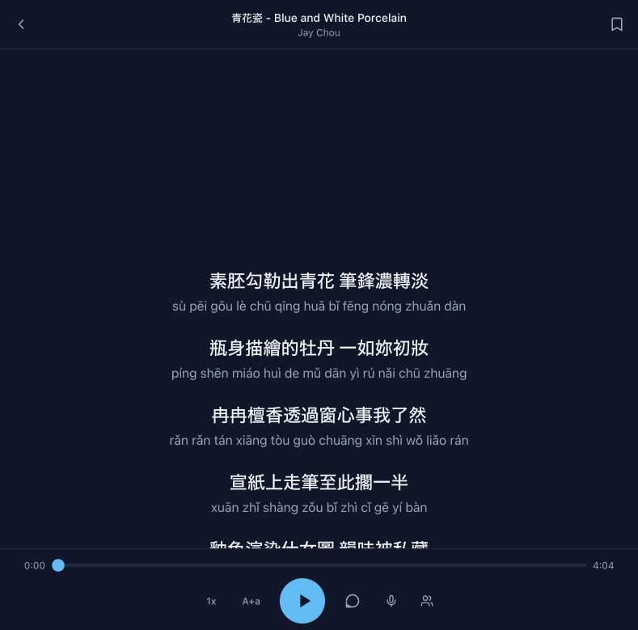

# SingLah

Karaoke lyrics with real-time Pinyin, Japanese Romaji, and Korean
romanization—built for people who can sing the song before they can read every
character.

[**Try SingLah live**](https://singlah.kooexperience.com/) · Installable PWA · Offline saves



## What it does

- Searches for synchronized song lyrics.
- Displays original lyrics and language-appropriate romanization together.
- Supports Chinese Pinyin, Japanese Romaji, and Korean romanization.
- Provides playback speed, text-size, restart, pitch, and party-mode controls.
- Saves songs for offline use as an installable progressive web app.
- Runs Chromaprint fingerprinting in the browser through WebAssembly.

## Run locally

```bash
npm ci
npm run dev
```

Production checks:

```bash
npm run lint
npm run build
```

The frontend is React, TypeScript, Vite, and Tailwind CSS. Language processing
uses `pinyin-pro`, Kuroshiro/Kuromoji, and `aromanize`; pitch analysis uses
Pitchy.
